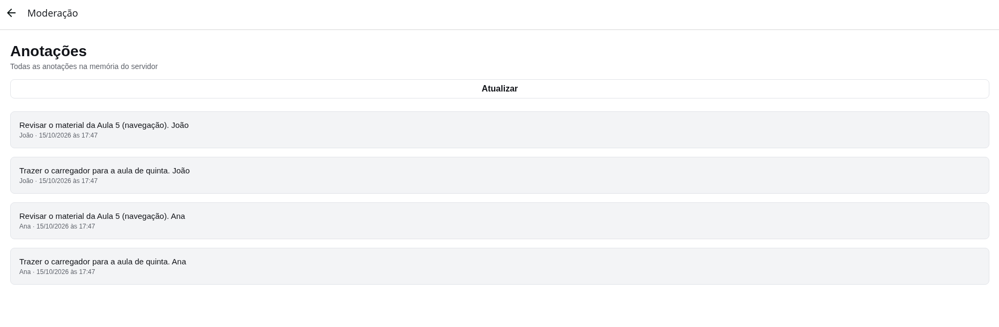
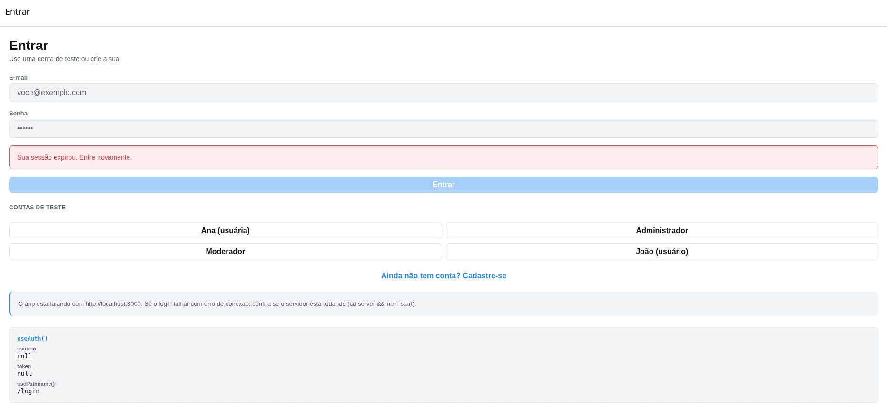

# Trabalho Prático II — Autenticação, Contexto e Rotas Protegidas

**Aluno:** **João Vitor Santiago da Silveira dos Santos**
**Disciplina:** Desenvolvimento de Aplicativos

Projeto construído sobre o app e o servidor da Aula 6 (React Native + Expo + TypeScript no app; Node.js + Express com dados em memória no servidor).

## Como executar

**Servidor** (terminal 1):

```bash
cd server
npm install
npm start
```

Ele sobe na porta 3000 e imprime as contas de teste. Opcional: `ATRASO=2000 npm start` aumenta o atraso artificial por requisição (útil para ver a tela de espera). No PowerShell: `$env:ATRASO=2000; npm start`.

**App** (terminal 2, na raiz do projeto):

```bash
npm install
npx expo start
```

O app descobre o IP do computador pelo Expo. Para apontar para outro endereço: `EXPO_PUBLIC_API_URL=http://... npx expo start`.

**Contas de teste** (criadas ao subir o servidor e listadas em `GET /`):

| Nome | E-mail | Senha | Papel |
| --- | --- | --- | --- |
| Administrador | `admin@ifrs.edu.br` | `admin123` | admin |
| Ana | `ana@ifrs.edu.br` | `123456` | usuario |
| João | `joao@ifrs.edu.br` | `13680` | usuario |
| Carlos (moderador) | `moderador@ifrs.edu.br` | `mod123` | moderador |

## Requisitos

### 4.1 Sessão expirada (401)

Toda requisição autenticada que receba 401 leva o app de volta ao login sozinho, com o aviso "Sua sessão expirou. Entre novamente.". O 403 não passa por esse caminho: continua só mostrando a mensagem de erro da tela.

**Onde o tratamento ficou centralizado:** em `src/services/api.ts`, dentro de `requisicao()`. Ali existe um callback de módulo (`definirAoExpirar`) que é chamado quando a resposta é 401, **a requisição enviou token** e a opção `tratar401` não foi desligada. A checagem do token evita que uma senha errada no login (que também é 401) seja tratada como sessão expirada. O `AuthProvider` registra esse callback em um `useEffect`; ele zera a sessão, apaga o token do armazenamento e marca `sessaoExpirada`, e o `Stack.Protected` faz o resto. Nenhuma tela repete `if (e.status === 401)`.

Dois pontos de decisão:

- O callback faz um **encerramento local** e não chama `sair()`: o token já morreu no servidor, então o `POST /auth/logout` só geraria outro 401.
- `sair` e `restaurar` usam `tratar401: false`. O logout voluntário não deve mostrar o aviso, e a restauração tem seu próprio tratamento (4.5).

Arquivos: `src/services/api.ts`, `src/contexts/auth-context.tsx`, `src/app/(auth)/login.tsx` (exibe o aviso).

### 4.2 Estado `carregando`

`AuthContextValue` ganhou `carregando`, verdadeiro enquanto um login ou cadastro está em andamento (`iniciarSessao` liga e desliga com `try/finally`). No layout raiz, enquanto `carregando` é verdadeiro, aparece a `TelaDeEspera` (indicador de atividade e mensagem).

**Resposta: como o erro do login não se perde.** O `erro` do login é um `useState` local da tela. Se a tela saísse da árvore durante a espera, o estado seria descartado e a mensagem sumiria quando a requisição falhasse. Por isso o `<Stack>` continua montado e a tela de espera é desenhada **por cima** dele, como uma camada com `StyleSheet.absoluteFill` e fundo opaco, depois do `Stack` no JSX. A tela de login nunca desmonta, então o erro continua lá quando a espera termina. A alternativa seria guardar o erro no contexto; preferi manter o estado do formulário na própria tela e resolver no layout.

Arquivos: `src/contexts/auth-context.tsx`, `src/app/_layout.tsx`, `src/components/tela-de-espera.tsx`, `src/app/(auth)/login.tsx`, `src/app/(auth)/cadastro.tsx`.

### 4.3 Detalhes da anotação (`/anotacoes/[id]`)

- **Servidor:** `GET /anotacoes/:id` responde 401 sem token válido e 404 quando a anotação não existe **ou** pertence a outra pessoa, com a mesma mensagem nos dois casos para não revelar que a anotação alheia existe.
- **App:** a lista de anotações passou a ser `anotacoes/index.tsx`, e cada item abre `anotacoes/[id].tsx`, que recebe o `id` pela rota (`useLocalSearchParams`), busca a anotação no servidor e trata três estados: carregando, erro (inclui 404) e sucesso. O sucesso mostra o texto e a data formatada (ex.: `29/09/2026 às 14:32`) pelo componente `AnotacaoDetalhe`.

**Resposta: por que a rota fica dentro de `(app)`?** O layout raiz só mantém o grupo `(app)` na árvore enquanto há usuário logado (`Stack.Protected guard={logado}`), e as telas de `(app)` leem `usuario` e `token` do contexto com a certeza de que existem. Se a rota fosse criada fora do grupo, ela não estaria sob nenhum guard: poderia ser aberta sem login (por link direto ou endereço na web), renderizaria sem `usuario` nem `token` e falharia com 401 do servidor; e, no logout, o usuário que estivesse nela não seria levado ao login, porque nenhum `guard` virou falso para ela. Ficando em `(app)`, ela some junto com o resto quando a sessão acaba.

Arquivos: `server/banco.js`, `server/index.js`, `src/app/(app)/anotacoes/index.tsx`, `src/app/(app)/anotacoes/[id].tsx`, `src/app/(app)/_layout.tsx`, `src/components/anotacao-item.tsx`, `src/components/anotacao-detalhe.tsx`, `src/services/api.ts`, `src/utils/formatar-data.ts`.

### 4.4 Papel `moderador`

- **Servidor:** novo papel e conta `moderador@ifrs.edu.br` / `mod123`, criada ao subir e listada em `GET /`. Novo middleware reutilizável `somentePapel('moderador', 'admin')`, que responde 403 a quem não tem o papel; `/usuarios` passou a usar `somentePapel('admin')` em vez de um `somenteAdmin` duplicado. Nova rota `GET /moderacao/anotacoes`, que devolve todas as anotações com o nome do autor (`usuario` recebe 403).
- **App:** tela `/moderacao` dentro de `Stack.Protected` para moderador e admin, e um `MenuLink` no início visível só para esses papéis. A condição "moderador ou admin" fica em uma função só, `podeModerar(papel)`. `/admin` continua exclusivo do admin.

**Arquivos que mudaram para acrescentar o papel:**

| Arquivo | Motivo |
| --- | --- |
| `server/banco.js` | conta de teste do moderador e `listarTodasAnotacoes()` com o nome do autor |
| `server/index.js` | middleware `somentePapel`, rota `/moderacao/anotacoes` e lista de rotas do `GET /` |
| `src/models/usuario.ts` | `Papel` com `'moderador'`, `podeModerar()` e o tipo `AnotacaoModeracao` (anotação com autor) |
| `src/services/api.ts` | `listarAnotacoesModeracao()` |
| `src/app/(app)/_layout.tsx` | `Stack.Protected` da tela de moderação |
| `src/app/(app)/index.tsx` | link para `/moderacao`, visível só para moderador e admin |
| `src/app/(app)/moderacao.tsx` | tela nova da moderação |
| `src/components/anotacoes-moderacao-item.tsx` | item da lista (texto, autor e data) |
| `src/app/(auth)/login.tsx` | atalho para entrar com a conta de teste do moderador |

### 4.5 Sessão que sobrevive ao reload

O token é gravado com `AsyncStorage` (chave `aula06:token`, em `src/services/sessao-storage.ts`) ao entrar ou cadastrar, e apagado ao sair e na saída por 401. Ao abrir o app, o `AuthProvider` lê o token salvo e chama `GET /auth/me`: token válido → entra direto; 401 → descarta o token e mostra o login; sem token → login. Só o token é guardado: o `usuario` vem sempre do `GET /auth/me`, então o papel nunca fica desatualizado.

**Sem "piscar":** `restaurando` começa `true` e o layout raiz devolve só a `TelaDeEspera` enquanto durar; o `Stack` (e portanto o login) nem existe ainda. Quando a restauração termina, o `Stack` monta já sabendo se há usuário.

**Resposta: servidor fora do ar na abertura (status 0).** O token salvo **é mantido** e o login aparece, sem o aviso de sessão expirada. Só o 401 descarta o token: um erro de conexão não prova que o token seja inválido, e apagá-lo faria o usuário perder a sessão por uma falha de rede. Quando o servidor voltar, o app não tenta restaurar sozinho: ao entrar de novo, o novo token substitui o antigo. Testei parando o servidor e recarregando o app logado: o login apareceu, sem o aviso de sessão expirada, e o token continuou guardado no armazenamento.

Arquivos: `src/contexts/auth-context.tsx`, `src/services/sessao-storage.ts`, `src/services/api.ts`, `src/app/_layout.tsx`.

### 4.6 Análise: funções recriadas a cada render

**Por que poderia ser um problema.** Todo componente que chama `useAuth()` re-renderiza quando o `value` do contexto muda por referência. Como `entrar`, `cadastrar`, `sair` e o objeto `value` são criados de novo a cada render do `AuthProvider`, qualquer render do provider, mesmo por um motivo que não altera a sessão, produziria um `value` "novo" e re-renderizaria todos os leitores (`SessaoAtual`, as telas, os layouts).

**É problema neste projeto?** Pouco. O `AuthProvider` fica no topo e o `children` que ele recebe vem de um componente que não re-renderiza; ele só re-renderiza quando o próprio estado muda (`sessao`, `carregando`, `restaurando`, `sessaoExpirada`), e nesses casos os leitores precisariam re-renderizar de qualquer jeito. Além disso, o `app.json` tem `reactCompiler: true`: o React Compiler memoiza automaticamente funções e objetos, mantendo a identidade de `entrar`, `cadastrar`, `sair` e `value` entre renders em que suas dependências não mudaram.

**Sem o React Compiler.** `useCallback` nas três funções e `useMemo` no `value`:

```tsx
const entrar = useCallback((email: string, senha: string) =>
  iniciarSessao(() => api.login(email, senha)), []);
const sair = useCallback(async () => { /* depende de sessao */ }, [sessao]);

const value = useMemo(
  () => ({ usuario: sessao?.usuario ?? null, token: sessao?.token ?? null,
           entrar, cadastrar, sair, carregando, restaurando, sessaoExpirada }),
  [sessao, entrar, cadastrar, sair, carregando, restaurando, sessaoExpirada],
);
```

**Evidência.** Coloquei `console.log` no `AuthProvider` e no `SessaoAtual`
(que lê o contexto) e repeti a mesma sequência (abrir o app, digitar 3 letras
no formulário e apagá-las, entrar e sair) com `reactCompiler: true` e `false`,
reiniciando com `npx expo start -c` a cada troca.

| | AuthProvider | SessaoAtual |
| --- | --- | --- |
| `reactCompiler: true` | 4 | 3 |
| `reactCompiler: false` | 4 | 10 |

O `AuthProvider` renderizou 4 vezes nos dois casos e não renderizou ao digitar:
ele só re-renderiza quando o próprio estado muda (`restaurando`, `carregando`,
`sessao`). Toda renderização do provider foi seguida de uma do leitor, o que é
esperado, porque o estado mudou e o `value` mudou de verdade. A diferença está
nas 6 renderizações extras do `SessaoAtual` sem o compilador, uma por tecla
digitada ou apagada: cada tecla re-renderiza a `LoginScreen`, que guarda o
estado do formulário, e sem memoização o filho `<SessaoAtual />` re-renderiza
junto, mesmo sem props. Com o compilador, o elemento é memoizado e essas
renderizações somem. Conclusão: o custo de recriar `entrar`, `cadastrar`,
`sair` e o `value` é pequeno aqui, porque o provider quase não re-renderiza por
conta própria; e o compilador elimina o trabalho desnecessário dos leitores.
Depois do teste voltei `reactCompiler` para `true` e removi os `console.log`.

## Rotas do servidor

| Método | Rota | Acesso | Respostas |
| --- | --- | --- | --- |
| GET | `/` | público | 200 (contas de teste e lista de rotas) |
| POST | `/auth/cadastro` | público | 201, 400, 409 |
| POST | `/auth/login` | público | 200, 400, 401 |
| GET | `/auth/me` | token | 200, 401 |
| POST | `/auth/logout` | token | 204, 401 |
| GET | `/anotacoes` | token | 200, 401 |
| POST | `/anotacoes` | token | 201, 400, 401 |
| GET | `/anotacoes/:id` | token (só o dono) | 200, 401, 404 |
| GET | `/moderacao/anotacoes` | moderador ou admin | 200, 401, 403 |
| GET | `/usuarios` | admin | 200, 401, 403 |

## Screenshots

| Tela de espera | Detalhe de uma anotação |
| --- | --- |
|  |  |

| Tela de moderação | Aviso de sessão expirada no login |
| --- | --- |
|  |  |

## Vídeo

[Vídeo no Google Drive](https://drive.google.com/file/d/1HMDX0CD82LO_KZVajD8cAxNcggO_vCe7/view?usp=drive_link)
